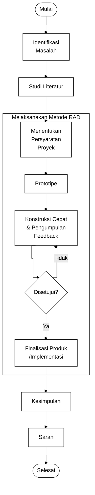

# Diagram Alur Metode RAD

# Aturan Notasi Sequence Diagram

1. Sequence diagram digunakan untuk menggambarkan interaksi berdasarkan urutan waktu.
2. Object ditempatkan di bagian atas diagram dan memiliki lifeline vertikal putus-putus.
3. Gunakan stereotipe UML sesuai peran object:
   - `actor` untuk pengguna atau pihak eksternal.
   - `boundary` untuk halaman atau antarmuka sistem.
   - `control` untuk proses atau pengendali alur.
   - `entity` untuk data atau basis data.
4. Pesan utama menggunakan panah solid, sedangkan pesan balikan menggunakan panah putus-putus/open.
5. Percabangan atau kondisi alternatif menggunakan frame `alt`, bukan decision diamond atau flowchart.
6. Satu diagram maksimal memuat empat object: actor, entity, control, dan boundary.
7. Teks pada message harus menggunakan deskripsi umum yang mudah dipahami dan tidak terlalu teknis.
8. Diagram detail harus tetap dapat dibaca secara mandiri dan menunjukkan trigger, urutan interaksi, hasil, serta kondisi alternatif yang relevan.
9. Komposisi nama object mengikuti aturan berikut:
   - `actor` menggunakan nama aktor yang berinteraksi dengan sistem.
   - `boundary` menggunakan nama fitur, misalnya `Approval Cuti` atau `Approval Cuti Disetujui`.
   - `control` menggunakan nama `Sistem`.
   - `entity` menggunakan nama `Database`.

```plantuml
@startuml
skinparam backgroundColor transparent
skinparam defaultFontColor black
skinparam activityBackgroundColor transparent
skinparam activityBorderColor black
skinparam activityFontColor black
skinparam activityDiamondBackgroundColor transparent
skinparam activityDiamondBorderColor black
skinparam activityDiamondFontColor black
skinparam activityArrowColor black
skinparam partitionBackgroundColor transparent
skinparam partitionBorderColor black
skinparam partitionFontColor black

start

:Identifikasi
Masalah;
:Studi Literatur;

partition "Melaksanakan Metode RAD" {
  :Menentukan
  Persyaratan
  Proyek;
  :Prototipe;

  repeat
    :Konstruksi Cepat
    & Pengumpulan
    Feedback;
  repeat while (Disetujui?) is (Tidak)

  :Finalisasi Produk
  /Implementasi;
}

:Kesimpulan;
:Saran;

stop
@enduml


```

# Diagram Alur Penelitian Modified

```plantuml
@startuml
skinparam backgroundColor transparent
skinparam defaultFontColor black
skinparam activityBackgroundColor transparent
skinparam activityBorderColor black
skinparam activityFontColor black
skinparam activityDiamondBackgroundColor transparent
skinparam activityDiamondBorderColor black
skinparam activityDiamondFontColor black
skinparam activityArrowColor black
skinparam partitionBackgroundColor transparent
skinparam partitionBorderColor black
skinparam partitionFontColor black

start

  :Menentukan
  Persyaratan
  Proyek;
  :Prototipe;

  repeat
    :Konstruksi Cepat
    & Pengumpulan
    Feedback;
  repeat while (Disetujui?) is (Tidak)

  :Finalisasi Produk
  /Implementasi;

stop
@enduml

```

# Diagram Alur Penelitian Modified - Mermaid


