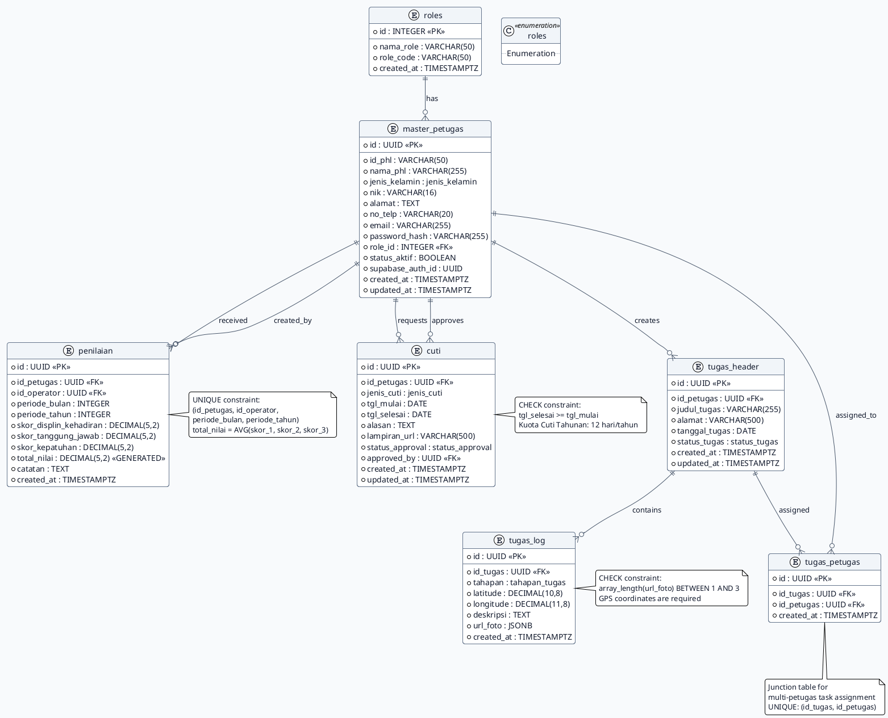

# Entity-Relationship Diagram (ERD)
# Sistem E-Kinerja

## Legenda

| Simbol | Arti |
|--------|------|
| `<<PK>>` | Primary Key |
| `<<FK>>` | Foreign Key |
| `<<enumeration>>` | Enum Type |
| `<<GENERATED>>` | Auto-generated Column |
| `||--o{` | One-to-Many (crow's foot) |
| `||--||` | One-to-One |

## Enum Types

| Enum Name | Values |
|-----------|--------|
| `jenis_kelamin` | 'L', 'P' |
| `tahapan_tugas` | 'Before', 'Ongoing', 'Finished' |
| `status_tugas` | 'Menunggu', 'Proses', 'Selesai' |
| `jenis_cuti` | 'Tahunan', 'Sakit', 'Alasan Penting' |
| `status_approval` | 'Menunggu', 'Disetujui', 'Ditangguhkan', 'Tidak Disetujui' |

## Constraints Penting

1. **Kuota Cuti**: 12 hari/tahun untuk jenis 'Tahunan'
2. **Foto Tugas**: Minimal 1, maksimal 3 foto per log
3. **GPS**: Wajib untuk setiap submit log tugas
4. **Penilaian Unik**: Kombinasi (id_petugas, id_operator, periode_bulan, periode_tahun) harus unik
