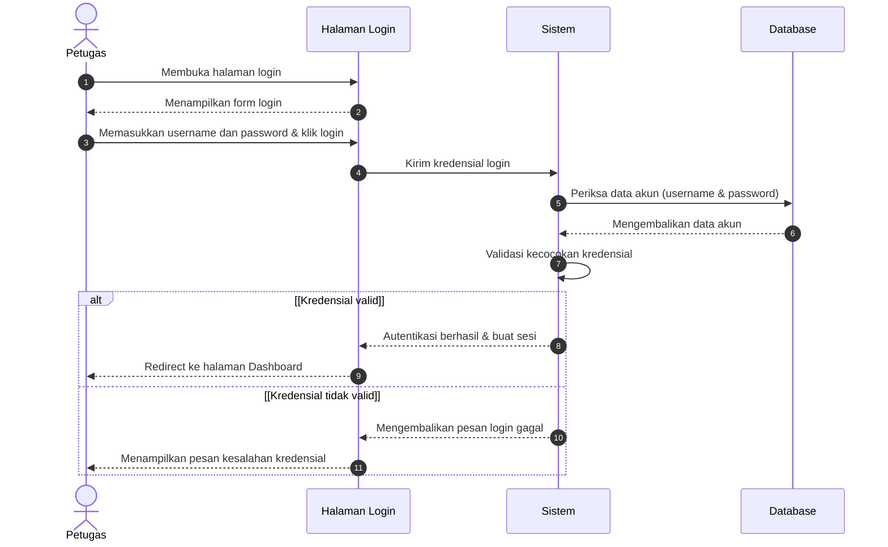
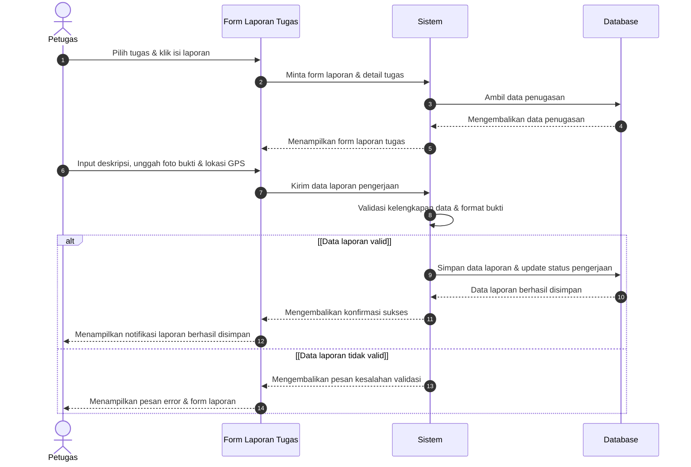
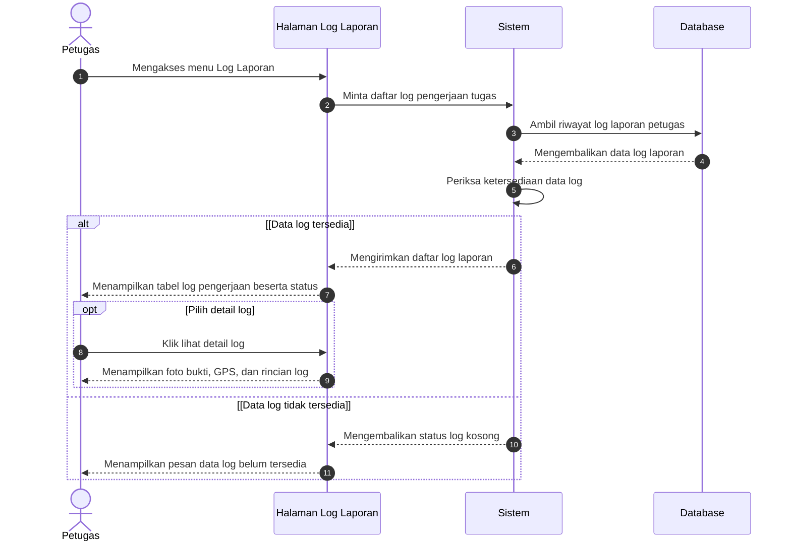
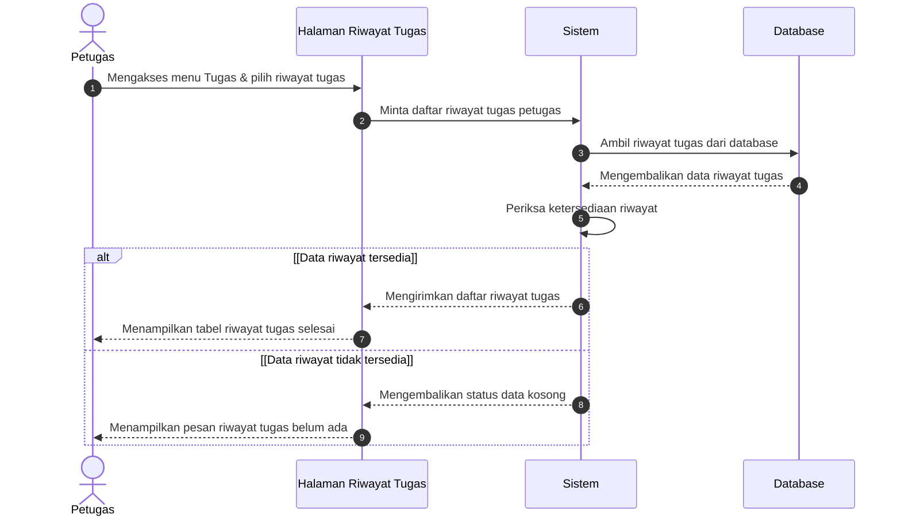
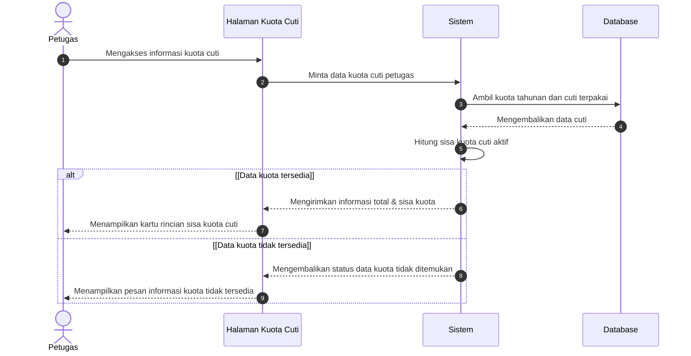
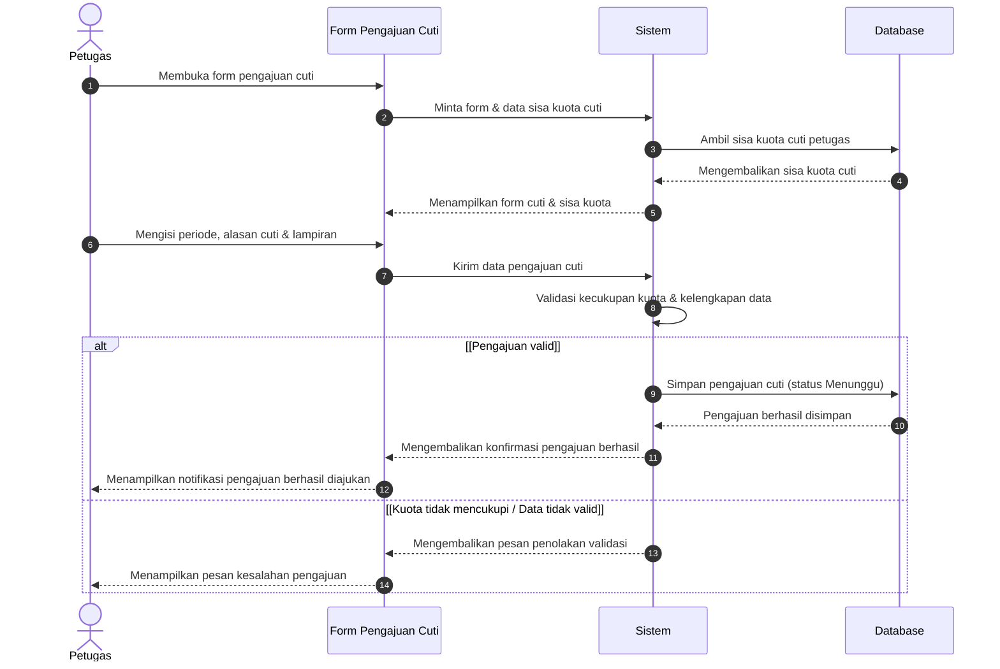
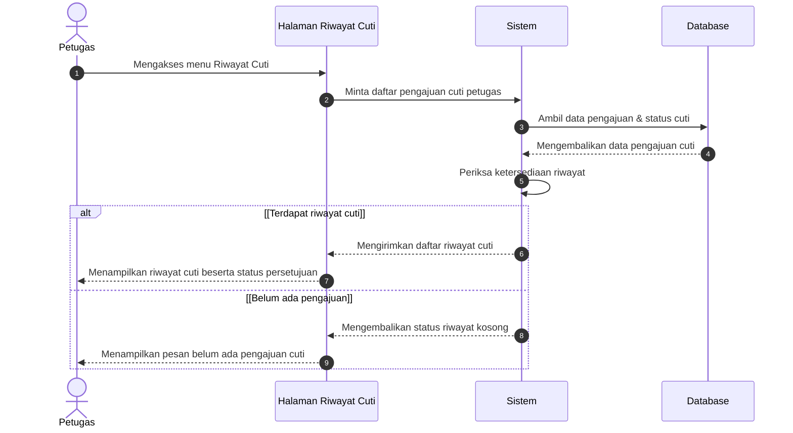
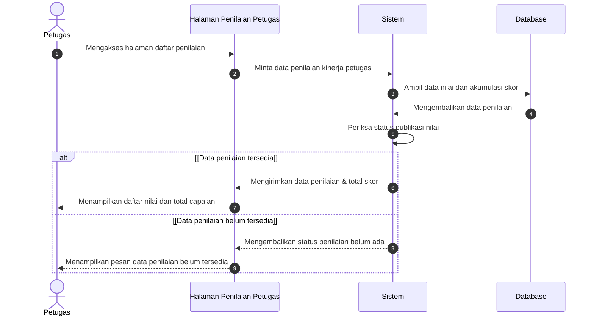
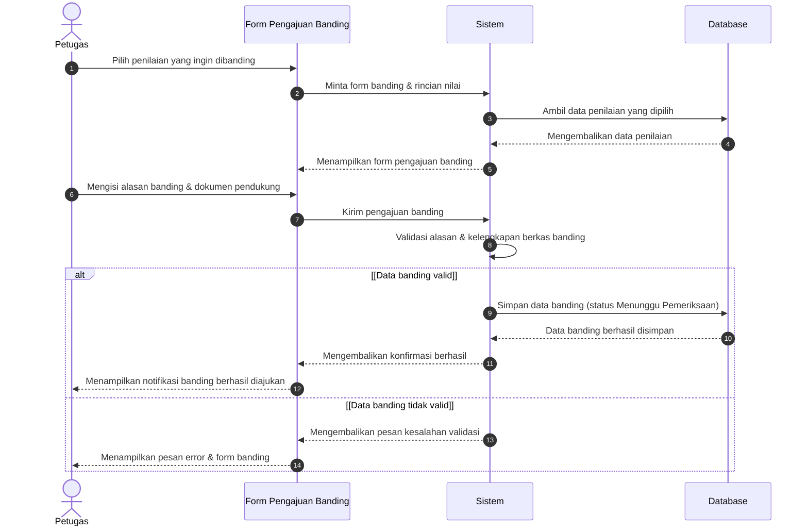

# Rencana Perbaikan Sequence Diagram Petugas (E-Kinerja)

Dokumen ini memuat analisis permasalahan, strategi perbaikan tata letak geometri, rancangan detail alur proses tiap halaman diagram, serta rencana verifikasi untuk berkas [`diagram/sequence_diagram/sequence_rad_revised_petugas_updated.drawio`](file:///C:/Users/openl/gdamar/laporan-ekinerja/diagram/sequence_diagram/sequence_rad_revised_petugas_updated.drawio).

---

## 1. Goal Description

Berdasarkan hasil telaah terhadap berkas [`sequence_rad_revised_petugas_updated.drawio`](file:///C:/Users/openl/gdamar/laporan-ekinerja/diagram/sequence_diagram/sequence_rad_revised_petugas_updated.drawio) dan berkas referensi pada folder [`diagram/sequence_diagram/images`](file:///C:/Users/openl/gdamar/laporan-ekinerja/diagram/sequence_diagram/images) (`activation_box.png`, `crud_example.png`, dan `read_example.png`), ditemukan dua masalah utama:

1. **Penempatan panah pesan (request dan response) tidak simetris / tidak horizontal dan meleset dari activation box:**
   - Koordinat Y sumber (`sourcePoint`) dan Y target (`targetPoint`) pada pesan request/response tidak sama (misalnya $y=285 \rightarrow y=290$, $y=336.08 \rightarrow y=360$, $y=425 \rightarrow y=406$, dsb.), sehingga garis panah miring / tidak tegak lurus (diagonal).
   - Titik X panah diarahkan ke garis sumbu lifeline ($x=100, 320, 540, 760$) dan bukan ke tepi batas luar activation box ($x=108, 312, 328, 532, 548, 752$). Hal ini menyebabkan panah menusuk ke dalam activation box atau menggantung di luar activation box.
   - Durasi/tinggi activation box tidak sinkron dengan kedatangan dan balikan pesan, serta terdapat beberapa activation box melayang tanpa pemicu pesan yang jelas.

2. **Alternative frame terlalu ke bawah dan kurang merepresentasikan detail alur:**
   - Seluruh alternative frame pada diagram Petugas diposisikan secara mekanis jauh di bawah ($y=700$ atau $y=600$), terpisah dari alur pesan utama ($y=220 \dots 565$).
   - Isi di dalam alternative frame sangat minim (hanya 1-2 pesan dummy seperti *"Menampilkan pesan kesalahan"* di $y=850$ dan self-arrow *"Memperbaiki/Memuat ulang"* di $y=960$).
   - Alur bisnis inti yang sebenarnya (misalnya aktor menginput form, mengunggah bukti/GPS, sistem melakukan validasi, lalu menyimpan ke database jika valid, atau menampilkan pesan kesalahan jika tidak valid sebagaimana dicontohkan pada `read_example.png` dan `crud_example.png`) belum tergambar di dalam diagram.

Rencana ini bertujuan merekonstruksi ke-9 diagram sequence Petugas (serta membersihkan halaman duplikat usang) agar presisi secara geometris, konsisten dengan aturan notasi UML proyek, dan mencerminkan alur bisnis use case serta activity diagram secara utuh.

---

## 2. User Review Required

> [!IMPORTANT]
> **Keputusan Struktur Halaman (Berdasarkan Arahan User):**
> - **Perubahan HANYA dilakukan pada diagram halaman 13 s.d. 21.**
> - **Di bawah halaman 13 (Halaman 1 s.d. 12) TIDAK DILAKUKAN PERUBAHAN SAMA SEKALI.**
> - Ke-9 halaman Petugas (Halaman 13-21) akan direkonstruksi secara penuh dengan geometri horizontal presisi, hooking activation box sempurna, serta alur detail di dalam alternative frame.

> [!WARNING]
> **Penulisan Istilah:** Sesuai aturan direktif Iterasi #4, istilah *"progress laporan"* telah diselaraskan menjadi *"status pengerjaan"*, dan pesan pada sequence diagram disederhanakan menggunakan kata kerja tindakan umum (misalnya: *Akses ...*, *Minta ...*, *Kirim ...*, *Validasi ...*, *Simpan ...*, *Kembalikan ...*, *Tampilkan ...*).

---

## 3. Standar Geometri & Notasi (Mengacu pada Gambar Referensi)

Berdasarkan telaah mendalam terhadap `activation_box.png`, `crud_example.png`, dan `read_example.png`:

```
Lifeline 0 (Actor)      Lifeline 1 (Boundary)    Lifeline 2 (Control)     Lifeline 3 (Entity)
Center: X=100           Center: X=320            Center: X=540            Center: X=760
Act: [92..108]          Act: [312..328]          Act: [532..548]          Act: [752..768]
     |                        |                        |                        |
     |--- Akses menu -------->|                        |                        |  (Y=220) [108 -> 312]
     |                        |--- Minta data -------->|                        |  (Y=280) [328 -> 532]
     |                        |                        |--- Query DB ---------->|  (Y=340) [548 -> 752]
     |                        |                        |<-- Return data --------|  (Y=400) [752 -> 548, dashed]
     |                        |<-- Kirim data ---------|                        |  (Y=460) [532 -> 328, dashed]
     |<-- Tampilkan data -----|                        |                        |  (Y=520) [312 -> 108, dashed]
```

### Aturan Geometri Panah & Activation Box:
1. **Panah Horizontal Mutlak**: Setiap panah memiliki $y_{\text{source}} == y_{\text{target}}$. Tidak boleh ada kemiringan vertikal ($|\Delta y| = 0$).
2. **Hooking Tepat pada Sisi Activation Box**:
   - Actor $\rightarrow$ Boundary: $x_1 = 108, x_2 = 312$ (panjang = 204px).
   - Boundary $\rightarrow$ Actor: $x_1 = 312, x_2 = 108$.
   - Boundary $\rightarrow$ Sistem: $x_1 = 328, x_2 = 532$ (panjang = 204px).
   - Sistem $\rightarrow$ Boundary: $x_1 = 532, x_2 = 328$.
   - Sistem $\rightarrow$ Database: $x_1 = 548, x_2 = 752$ (panjang = 204px).
   - Database $\rightarrow$ Sistem: $x_1 = 752, x_2 = 548$.
   - Self-call Sistem (Validasi): Titik awal di $x=548, y$, melengkung ke $x=575$, kembali ke $x=548, y+25$.
3. **Activation Box Tersegmentasi**:
   - Lebar activation box adalah $16\text{px}$, berpusat pada lifeline.
   - Database hanya aktif saat menerima kueri dari Sistem hingga mengirimkan balikan data (idle di luar itu).
   - Sistem hanya aktif selama menerima request, memproses, memvalidasi, dan meneruskan hasil.
   - Boundary aktif saat menerima interaksi pengguna hingga merespons kembali ke aktor.
4. **Alternative Frame Proporsional**:
   - Frame `alt` diletakkan tepat pada titik terjadinya percabangan (setelah tahap validasi / pengecekan data).
   - Header frame murni teks `"alt"` dengan shape `umlFrame` ($w=780, h=\dots$), dan label kasus di sampingnya bertuliskan `[Nama Kasus]` sebagai child label independen.
   - Pembatas antar kondisi menggunakan garis putus-putus (`dashed=1;endArrow=none;`) dengan label `else` di bawah garis pembatas.

---

## 4. Proposed Changes: Rincian Alur 9 Diagram Petugas

Berikut adalah rancangan alur proses dan pembagian alternatif untuk masing-masing dari 9 sequence diagram Petugas:

---

### Page 13: Login Petugas
- **Actor**: `Petugas`
- **Boundary**: `Halaman Login`
- **Control**: `Sistem`
- **Entity**: `Database`



---

### Page 14: Membuat Laporan Pengerjaan Tugas
- **Actor**: `Petugas`
- **Boundary**: `Form Laporan Tugas`
- **Control**: `Sistem`
- **Entity**: `Database`



---

### Page 15: Melihat Log Laporan
- **Actor**: `Petugas`
- **Boundary**: `Halaman Log Laporan`
- **Control**: `Sistem`
- **Entity**: `Database`



---

### Page 16: Melihat Daftar Riwayat Tugas
- **Actor**: `Petugas`
- **Boundary**: `Halaman Riwayat Tugas`
- **Control**: `Sistem`
- **Entity**: `Database`



---

### Page 17: Melihat Kuota Cuti
- **Actor**: `Petugas`
- **Boundary**: `Halaman Kuota Cuti`
- **Control**: `Sistem`
- **Entity**: `Database`



---

### Page 18: Mengajukan Cuti
- **Actor**: `Petugas`
- **Boundary**: `Form Pengajuan Cuti`
- **Control**: `Sistem`
- **Entity**: `Database`



---

### Page 19: Melihat Riwayat Cuti
- **Actor**: `Petugas`
- **Boundary**: `Halaman Riwayat Cuti`
- **Control**: `Sistem`
- **Entity**: `Database`



---

### Page 20: Melihat Daftar Penilaian
- **Actor**: `Petugas`
- **Boundary**: `Halaman Penilaian Petugas`
- **Control**: `Sistem`
- **Entity**: `Database`



---

### Page 21: Mengajukan Banding
- **Actor**: `Petugas`
- **Boundary**: `Form Pengajuan Banding`
- **Control**: `Sistem`
- **Entity**: `Database`



---

## 5. Rencana Modifikasi Berkas

### A. Diagram Draw.io (`diagram/sequence_diagram/sequence_rad_revised_petugas_updated.drawio`)
1. **Halaman 1 s.d. 12 Dipertahankan Utuh**: Tidak ada modifikasi atau penghapusan pada halaman 1 sampai dengan 12.
2. **Rekonstruksi Halaman Petugas (Halaman 13 s.d. 21)**:
   - Menghitung ulang seluruh koordinat elemen pada ke-9 diagram Petugas.
   - Mengatur posisi Y pesan secara strictly monotonic ($y_i < y_{i+1}$).
   - Memastikan $y_{\text{source}} == y_{\text{target}}$ pada semua pesan horizontal.
   - Menghubungkan titik panah secara presisi ke tepi activation box ($x=108, 312, 328, 532, 548, 752$).
   - Menyusun frame `alt` di posisi yang proporsional mengelilingi cabang validasi/hasil, lengkap dengan divider garis putus-putus dan label `else`.
   - Mengatur activation box agar hanya aktif pada fase eksekusi terkait dan tidak monolitik.

### B. Dokumentasi Review (`diagram/sequence_diagram/sequence_rad_revised-review.md`)
- Menambahkan bab **Sequence Diagram Review - Iterasi Petugas (Revisi Geometri & Alur Detail)**.
- Mendokumentasikan perbaikan koordinat panah, penataan frame alternatif, segmentasi activation box, dan penghapusan halaman duplikat.

---

## 6. Verification Plan

### Automated Tests
1. **Validasi Sintaks XML**:
   Memeriksa bahwa berkas XML dapat di-parse dengan sempurna oleh `xml.etree.ElementTree` tanpa error parsing dan encoding terjaga.
2. **Pemeriksaan Geometri & Hooking Panah**:
   Menjalankan skrip Python untuk memverifikasi:
   - Nilai kemiringan panah horizontal: $\forall \text{message}, |y_{\text{src}} - y_{\text{tgt}}| == 0$.
   - Endpoint panah: $x_{\text{src}}$ dan $x_{\text{tgt}}$ berada tepat di tepi activation box terkait dan tidak ada panah melayang (*dangling*).
   - Seluruh pesan dalam frame berada dalam rentang koordinat vertikal frame ($y_{\text{frame}} \le y_{\text{msg}} \le y_{\text{frame}} + h_{\text{frame}}$).
   - Tidak ada activation box monolitik (tinggi $> 900\text{px}$).

### Manual Verification
1. Membuka diagram di visualisasi Draw.io / extension VS Code untuk memastikan seluruh teks terbaca jelas di atas panah.
2. Memastikan tidak ada garis panah yang bertumpuk atau overlap dengan kotak aktivasi.
3. Memastikan frame `alt` membungkus kedua cabang alur secara proporsional dan tidak terpotong di tepi canvas.
